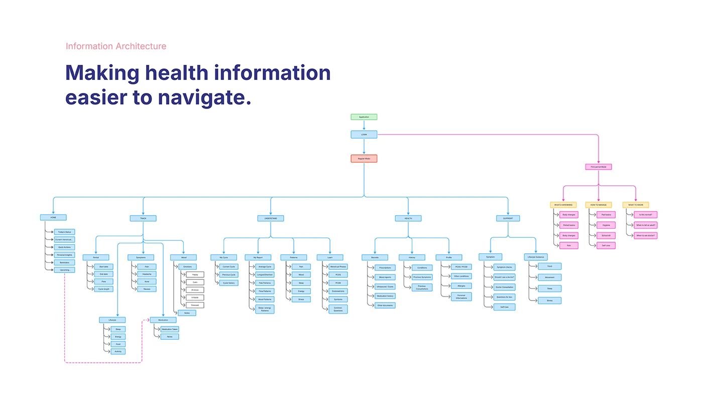

# OVIAH 'Making health information easier to navigate' full information-architecture sitemap tree

**Discipline:** app · **Design type:** UX documentation · **Design style:** Minimalist
**Tags:** information-architecture, sitemap, ux-documentation, lilac, tree-diagram

## What it is
A dense colour-coded sitemap tree from Application through Login and Register into five main sections (Home, Track, Conditions, Health, Support), each branching into sub-pages and leaf items, plus a separate pink-outlined branch for a floating action button's quick-add options.

## What it means
Exhaustive and disciplined; mapping the entire app's structure before UI design prevents missing or orphaned screens.

## Techniques
- Colour-code root, section and leaf nodes differently.
- Branch a floating action button's shortcuts as a separate tree.
- Map the complete app structure before any screen design begins.

## Best for
- Information architecture documentation
- Sitemaps
- Content structure planning

## Vocabulary
- **Information architecture** — The organisation and structure of an app or site's content.
- **Leaf node** — An end point in a tree diagram with no further children.
