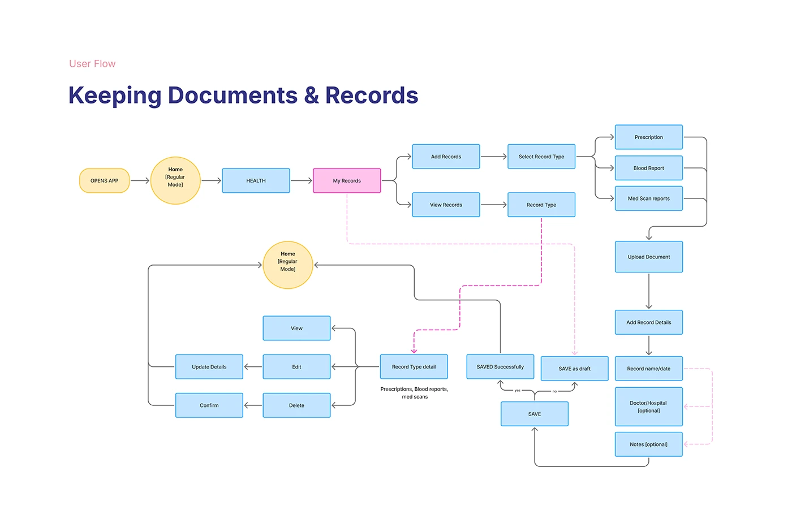

# OVIAH 'Keeping Documents & Records' user flow: a branching flowchart of add, view, edit and save states

**Discipline:** app · **Design type:** UX documentation · **Design style:** Minimalist
**Tags:** user-flow, flowchart, health-records, lilac, ux-documentation

## What it is
A white slide titled 'User Flow — Keeping Documents & Records' with a branching flowchart in yellow, blue and pink boxes: from opening the app and Home, into My Records, splitting into Add Records and View Records paths, through record types (Prescription, Blood Report, Med Scan), upload and detail steps, down to edit/delete/confirm and save/save-as-draft states, linked by solid and dashed arrows.

## What it means
Exhaustive and precise; colour-coded boxes and dashed return paths show every branch of a real feature was mapped.

## Techniques
- Colour-code flowchart nodes by type (start, screen, decision).
- Use dashed arrows for secondary or return paths.
- Branch a flow to cover add, view, edit and delete in one diagram.

## Best for
- User flow documentation
- Feature specification
- UX process decks

## Vocabulary
- **Flowchart** — A diagram showing the sequence and branches of a process.
- **Return path** — A flow line showing how a user gets back to a prior state.
