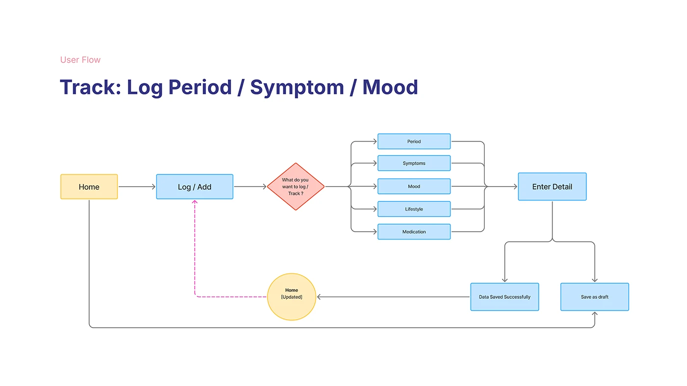

# OVIAH 'Track: Log Period / Symptom / Mood' user flow with a diamond decision node branching to five log types

**Discipline:** app · **Design type:** UX documentation · **Design style:** Minimalist
**Tags:** user-flow, flowchart, decision-node, lilac, logging

## What it is
A flowchart from Home through 'Log / Add' into a red diamond decision ('What do you want to log/track?') branching to five options (Period, Symptoms, Mood, Lifestyle, Medication), converging on 'Enter Detail', then splitting to 'Data Saved Successfully' or 'Save as draft', looping back to an updated Home via a dashed arrow.

## What it means
Clear and looping; the diamond decision node makes a five-way branch easy to follow at a glance.

## Techniques
- Use a diamond shape specifically for decision points.
- Converge multiple branches back into one shared step.
- Loop the flow back to an 'updated' version of the start state.

## Best for
- Logging and tracking flows
- Decision-point diagrams
- UX flow documentation

## Vocabulary
- **Decision node** — A diamond-shaped flowchart step representing a choice.
- **Flow loop** — A path that returns to an earlier state, often updated.
