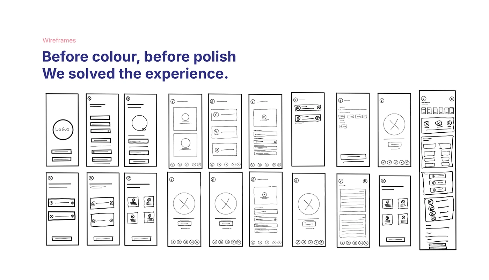

# OVIAH low-fidelity wireframes: 'Before colour, before polish, We solved the experience' — 18 hand-drawn screens

**Discipline:** app · **Design type:** Wireframe showcase · **Design style:** Minimalist
**Tags:** wireframes, low-fidelity, sketch, ux-process, hand-drawn

## What it is
A grid of 18 hand-sketched phone wireframes in black ink on white, covering splash, onboarding, home, tracking and settings screens, each with rough placeholder shapes for logos, buttons, circles and lists, captioned by the statement 'Before colour, before polish. We solved the experience.'

## What it means
Foundational and honest; sketchy hand-drawn frames prove the flow was validated before any visual design began.

## Techniques
- Sketch wireframes by hand to keep early ideas fast and disposable.
- State a process philosophy directly as the slide's headline.
- Cover the full flow breadth even at the roughest fidelity.

## Best for
- Early-stage UX documentation
- Design process storytelling
- Wireframe presentations

## Vocabulary
- **Low-fidelity wireframe** — A rough, quickly made layout sketch focused on structure.
- **Placeholder shape** — A simple shape standing in for future content.
