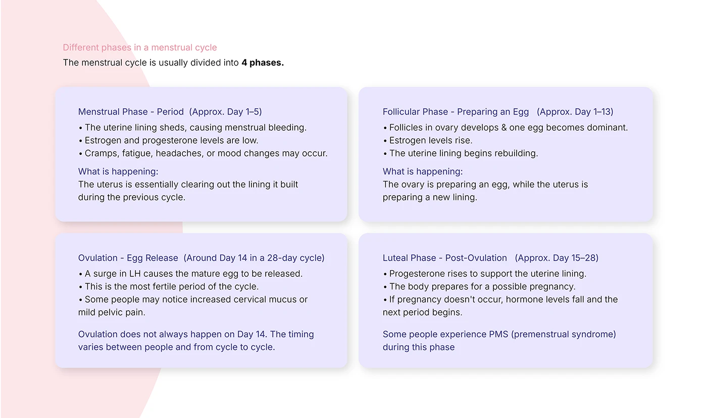

# OVIAH educational slide: the four menstrual cycle phases explained in a 2x2 lilac card grid

**Discipline:** app · **Design type:** UX documentation · **Design style:** Minimalist
**Tags:** health-education, period-tracking, lilac, cards, research

## What it is
A white slide titled 'Different phases in a menstrual cycle' with a 2x2 grid of lilac cards (Menstrual, Follicular, Ovulation, Luteal), each naming its approximate day range, bullet facts and a 'What is happening' explanation.

## What it means
Educational and credible; grounding app content in real physiology builds trust before showing any UI.

## Techniques
- Explain domain knowledge before showing the product.
- Pair each phase with both facts and a plain-language summary.
- Use a consistent card template across all four phases.

## Best for
- Health education content
- Domain research slides
- Content strategy documentation

## Vocabulary
- **Domain knowledge** — Background subject expertise informing a design.
- **Card grid** — Content arranged in equal rectangular cells.
