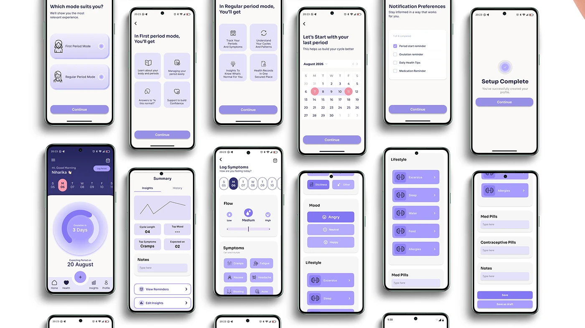

# OVIAH onboarding and daily logging: mode selection, calendar setup, symptom and lifestyle tracker screens

**Discipline:** app · **Design type:** Onboarding screens · **Design style:** Minimalist
**Tags:** onboarding, period-tracking, lilac, symptom-logging, forms

## What it is
A tilted grid of 15 phone screens: mode selection (First Period vs Regular), a feature preview grid, a calendar for last-period date, notification preferences, a setup-complete screen, the home dashboard, an insights summary, a symptom logger (flow, mood, symptoms), and lifestyle/medication tracking forms with icon toggles.

## What it means
Personalised and thorough; branching onboarding by period stage shows the app adapts to very different users.

## Techniques
- Branch onboarding early based on a key user difference.
- Preview what each mode unlocks before committing.
- Use icon toggle grids for fast symptom logging.

## Best for
- Health app onboarding
- Personalised setup flows
- Daily logging UX

## Vocabulary
- **Branching onboarding** — Onboarding that adapts based on an early user choice.
- **Icon toggle** — A selectable button combining an icon and label.
