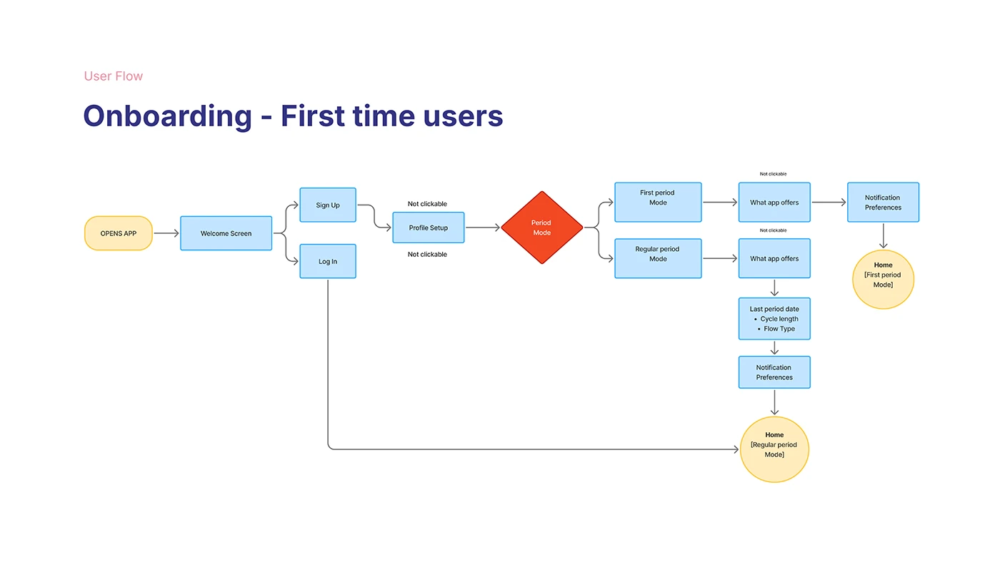

# OVIAH 'Onboarding — First time users' flowchart with a period-mode diamond branching to two setup paths

**Discipline:** app · **Design type:** UX documentation · **Design style:** Minimalist
**Tags:** user-flow, onboarding, flowchart, decision-node, lilac

## What it is
A flowchart from 'Opens App' through a welcome screen, sign-up/login, profile setup and a red 'Period Mode' diamond branching into First Period Mode and Regular Period Mode paths, each with its own app-preview and notification steps, converging on separate 'Home' end states, with 'Not clickable' labels marking read-only screens.

## What it means
Precise and developer-friendly; marking non-interactive screens prevents ambiguity during handoff.

## Techniques
- Label read-only screens explicitly as 'Not clickable'.
- End each onboarding branch at its own tailored home state.
- Use a diamond decision node to branch by user type early.

## Best for
- Onboarding flow specification
- Branching flow documentation
- Developer handoff diagrams

## Vocabulary
- **Not clickable** — A label marking a screen or state with no interactive action.
- **Branch convergence** — Where separate flow paths lead to related but distinct end states.
