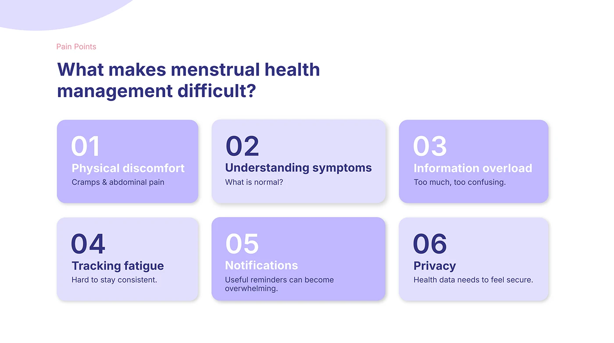

# OVIAH pain points: six numbered lilac cards answering 'What makes menstrual health management difficult?'

**Discipline:** app · **Design type:** UX documentation · **Design style:** Minimalist
**Tags:** pain-points, ux-research, numbered-cards, lilac, problem-framing

## What it is
A 3x2 grid of alternating light and mid-lilac cards, each with a large numeral (01–06) and a short pain point: Physical discomfort, Understanding symptoms, Information overload, Tracking fatigue, Notifications, Privacy, each with a one-line elaboration.

## What it means
Clear and prioritised; numbering pain points implies an order of importance the design should address first.

## Techniques
- Number findings to imply a priority order.
- Pair a short title with a single-line elaboration per card.
- Alternate card tints across a numbered grid for rhythm.

## Best for
- UX research pain-point summaries
- Problem framing slides
- Design brief documentation

## Vocabulary
- **Pain point** — A specific problem or frustration a user experiences.
- **Numbered card** — A card led by a large index number for ordering.
