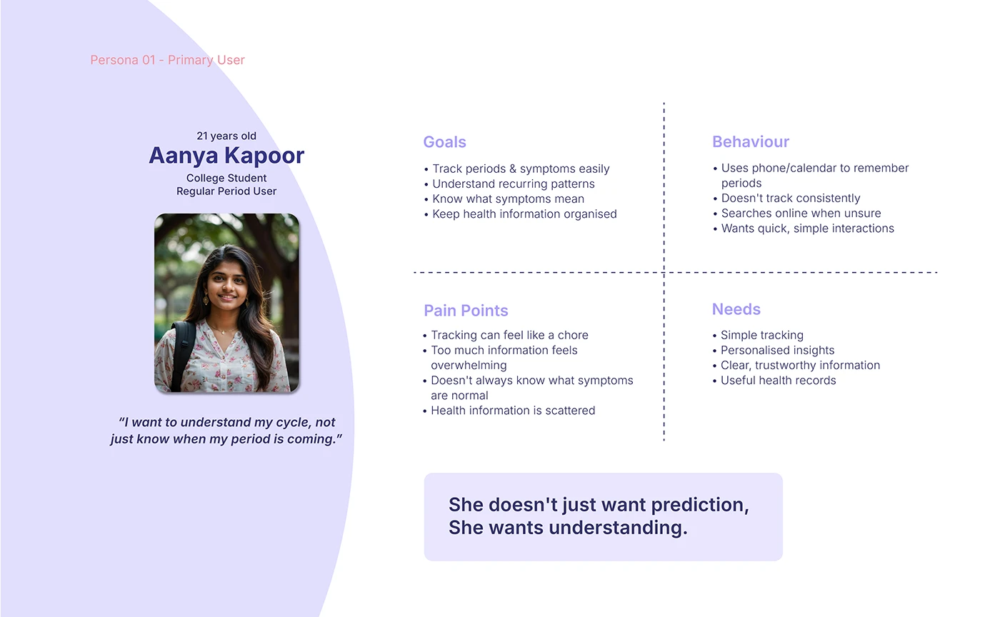

# OVIAH persona 'Aanya Kapoor': photo and quote beside a four-quadrant goals/behaviour/pain-points/needs grid

**Discipline:** app · **Design type:** UX documentation · **Design style:** Minimalist
**Tags:** persona, ux-research, lilac, quadrant, quote

## What it is
A slide with a lilac blob background holding Aanya Kapoor's photo, age, occupation and a pull-quote ('I want to understand my cycle, not just know when my period is coming.'), beside a four-quadrant grid (Goals, Behaviour, Pain Points, Needs) split by dashed lines, closing with a bolded insight line.

## What it means
Human and structured; the quote humanises the persona while the quadrant keeps the research scannable.

## Techniques
- Split persona research into a four-quadrant grid with dashed dividers.
- Lead with a first-person pull-quote that states the real need.
- Close with one bolded sentence summarising the insight.

## Best for
- Persona documentation
- UX research decks
- User-centred design presentations

## Vocabulary
- **Persona** — A fictional profile representing a group of real users.
- **Quadrant grid** — Content split into four labelled sections.
