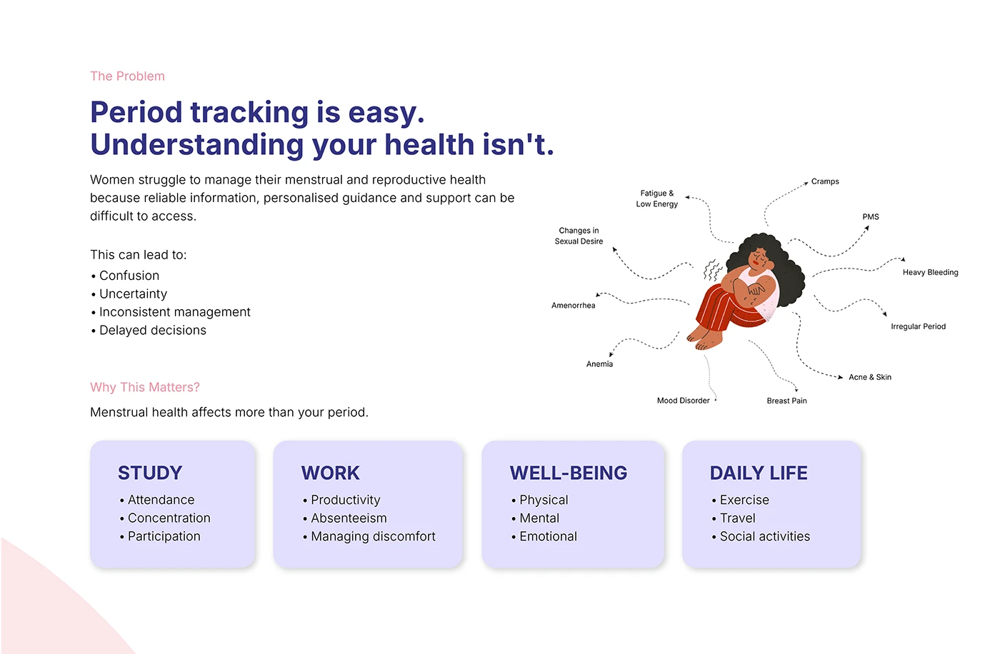

# OVIAH period-tracker problem slide: a symptom callout illustration and four lilac impact cards

**Discipline:** app · **Design type:** Case study slide · **Design style:** Minimalist
**Tags:** ux-research, health, period-tracking, lilac, illustration, problem-statement

## What it is
A white slide headed 'Period tracking is easy. Understanding your health isn't.' with a bullet list of consequences, a flat illustration of a woman with dotted lines pointing to symptoms (Cramps, PMS, Heavy Bleeding, Acne & Skin), and four lilac cards (Study, Work, Well-being, Daily Life) each with bullet impacts.

## What it means
Empathetic and evidence-based; mapping symptoms directly onto a figure makes an abstract health problem visceral.

## Techniques
- Point dotted lines from a figure to named symptoms.
- Group real-world impact into labelled category cards.
- Pair a 'what' statement with a 'why it matters' section.

## Best for
- Health app UX research
- Problem framing slides
- Case study openers

## Vocabulary
- **Symptom map** — An illustration linking a body to labelled symptoms.
- **Impact card** — A card grouping consequences of a problem by category.
