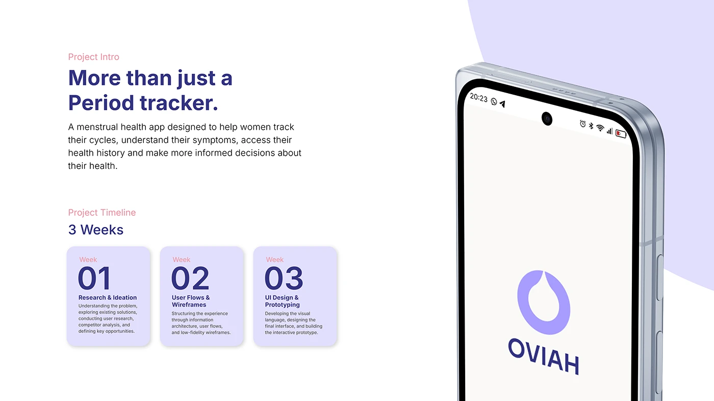

# OVIAH 'More than just a Period tracker' intro with a three-week timeline beside a tilted splash-screen phone

**Discipline:** app · **Design type:** Case study intro slide · **Design style:** Minimalist
**Tags:** case-study-intro, timeline, lilac, splash-screen, project-scope

## What it is
A white slide with a reframing headline and description, a 'Project Timeline — 3 Weeks' section with three lilac cards (Week 01 Research & Ideation, Week 02 User Flows & Wireframes, Week 03 UI Design & Prototyping), beside a large tilted phone showing the OVIAH splash screen on a purple blob backdrop.

## What it means
Scoped and credible; naming exact weekly phases shows the whole process fit a realistic, disciplined timeline.

## Techniques
- State the project timeline as named weekly phases.
- Open with a reframing headline before the details.
- Balance a text-heavy left side with one large hero device.

## Best for
- Case study introductions
- Project scope slides
- Process timeline documentation

## Vocabulary
- **Reframing headline** — An opening line that redefines what a product really is.
- **Weekly phase** — A project stage bounded by a specific week.
