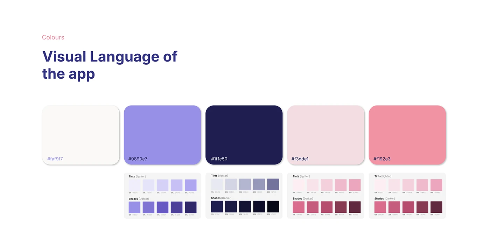

# OVIAH research summary: four bold stat cards (82 responses, 07 interviews, 04 competitors, 01 opportunity) beside a phone's onboarding buttons

**Discipline:** app · **Design type:** Case study slide · **Design style:** Minimalist
**Tags:** research-summary, stats, lilac, case-study, onboarding

## What it is
A 2x2 grid of lilac cards with huge numerals and labels ('82 Survey Responses', '07 User Interviews', '04 Competitors Studied', '01 Design Opportunity'), beside a cropped phone screen showing 'Get Started' and 'I Already have an Account' buttons.

## What it means
Confident and concise; distilling a whole research phase into four big numbers makes rigour easy to skim.

## Techniques
- Summarise a research phase as four headline numbers.
- Use consistent card sizing so numbers, not cards, draw focus.
- Pair a research recap with a glimpse of where it led.

## Best for
- Case study research summaries
- Process recap slides
- Portfolio stat highlights

## Vocabulary
- **Stat card** — A card highlighting one number as its focal point.
- **Research recap** — A condensed summary of a research phase's scope.
