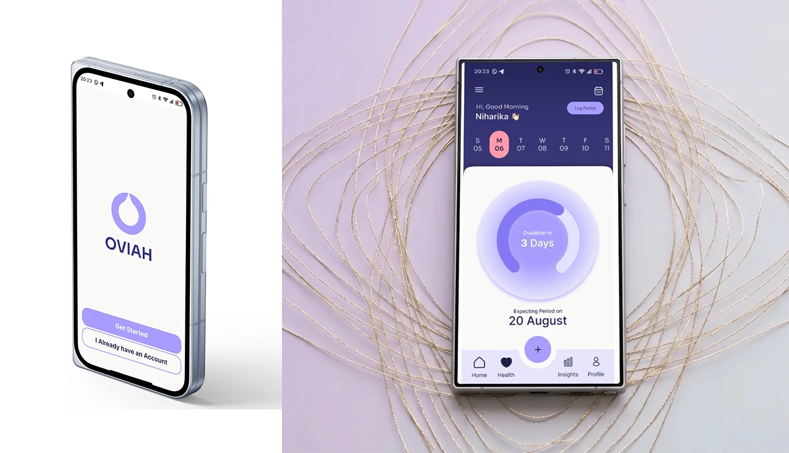

# OVIAH splash screen and home dashboard shown side by side as tilted phone mockups on a gold-thread backdrop

**Discipline:** app · **Design type:** Device mockup scene · **Design style:** Minimalist
**Tags:** mockup, splash-screen, dashboard, lilac, phone-mockup

## What it is
Two tilted phone mockups: a white splash screen with the OVIAH droplet logo and 'Get Started' buttons on a plain background, and the home dashboard (greeting, week strip, ovulation countdown ring, 'Expecting Period on 20 August') resting on a backdrop of looping gold threads.

## What it means
Polished and contrasting; pairing a plain splash mockup with an elaborately styled dashboard mockup shows range in presentation.

## Techniques
- Vary mockup backdrop elaborateness to suit each screen's role.
- Tilt devices slightly for a more dynamic composition.
- Use decorative thread or ribbon textures for a premium feel.

## Best for
- App store screenshots
- Portfolio presentation mockups
- Splash and home screen pairs

## Vocabulary
- **Thread backdrop** — A decorative looping-line texture behind a mockup.
- **Splash screen** — The first branded screen shown when an app opens.
