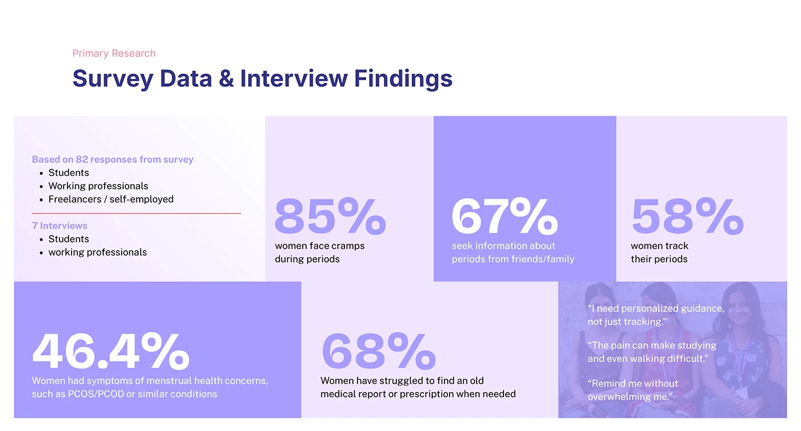

# OVIAH primary research slide: a lilac stat grid of survey percentages beside real interview quotes

**Discipline:** app · **Design type:** UX documentation · **Design style:** Minimalist
**Tags:** ux-research, survey-data, stats, lilac, quotes

## What it is
A slide titled 'Survey Data & Interview Findings' with a tinted-block grid: sample details (82 survey responses, 7 interviews), large bold percentages (85% face cramps, 67% ask friends/family, 58% track periods, 46.4% have PCOS/PCOD-type symptoms, 68% lost an old medical report), and a photo tile with three quoted pain points.

## What it means
Evidence-backed and human; big stats paired with verbatim quotes make the research feel both rigorous and real.

## Techniques
- Vary tile size to emphasise the most important stats.
- Include a sample-size note for credibility.
- End a stat grid with direct user quotes, not just numbers.

## Best for
- UX research readouts
- Survey data presentations
- Evidence-based pitch decks

## Vocabulary
- **Sample size** — The number of respondents a survey is based on.
- **Verbatim quote** — A user's exact words used as evidence.
