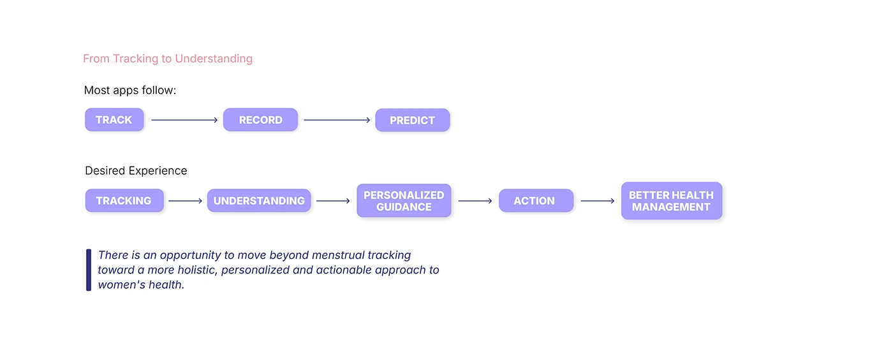

# OVIAH 'From Tracking to Understanding': a three-step industry flow versus a five-step desired flow

**Discipline:** app · **Design type:** UX documentation · **Design style:** Minimalist
**Tags:** ux-strategy, flow-comparison, lilac, insight, research

## What it is
A white slide comparing 'Most apps follow' (Track → Record → Predict, three purple pills with arrows) against the 'Desired Experience' (Tracking → Understanding → Personalized Guidance → Action → Better Health Management, five pills), closing with an italic insight statement in a left-bordered quote block.

## What it means
Strategic and persuasive; stretching three steps into five makes the product's added value visually obvious.

## Techniques
- Show the industry-standard flow before your improved one.
- Grow the number of steps to visualise added value.
- Close a comparison with a left-bordered italic insight.

## Best for
- Product strategy slides
- UX research insights
- Competitive differentiation

## Vocabulary
- **Blockquote styling** — A left-border and italic treatment marking a key insight.
- **Flow expansion** — Adding meaningful steps to show deeper value.
