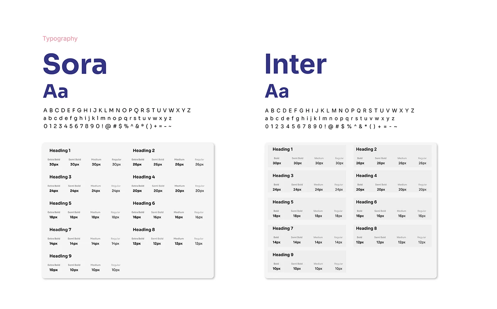

# OVIAH typography guide: Sora and Inter compared side by side with a nine-level heading scale

**Discipline:** app · **Design type:** Typography and colour guide · **Design style:** Minimalist
**Tags:** typography, design-system, font-specimen, heading-scale, lilac

## What it is
A white page with two typeface specimens side by side — 'Sora' and 'Inter' — each showing the alphabet, numerals and a table of nine heading levels (Heading 1–9) with weight (Extra Bold/Semi Bold/Medium/Regular) and pixel size for each.

## What it means
Comparative and precise; laying two candidate typefaces side by side makes the final choice easy to defend.

## Techniques
- Compare two candidate typefaces in the same layout.
- Tabulate every heading level's weight and size.
- Show the full character set to judge legibility.

## Best for
- Typography selection
- Design system documentation
- Style guide pages

## Vocabulary
- **Type specimen** — A sample showing a typeface's characters and styles.
- **Heading scale** — The defined sizes for each heading level in a system.
