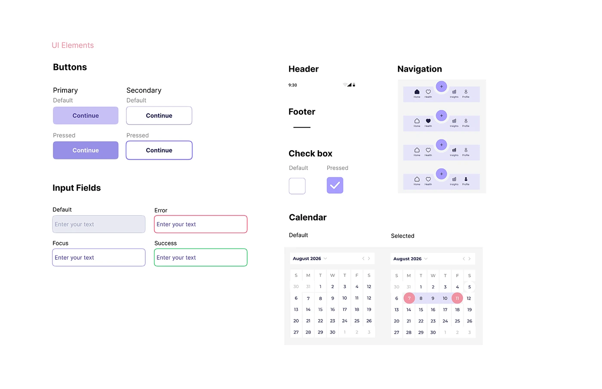

# OVIAH UI elements sheet: button, input, checkbox, navigation and calendar states in lilac

**Discipline:** app · **Design type:** Design system documentation · **Design style:** Minimalist
**Tags:** design-system, ui-components, states, lilac, calendar

## What it is
A white 'UI Elements' page documenting component states: primary/secondary buttons (default/pressed), input fields (default, focus, error, success), a checkbox (default/pressed), a header and footer spec, a bottom navigation bar with an active-tab highlight, and a calendar in default and date-selected states.

## What it means
Systematic and implementation-ready; documenting every state removes guesswork for whoever builds the app.

## Techniques
- Document each component in every interactive state.
- Colour-code input feedback (red for error, green for success).
- Show the same calendar twice to contrast default and selected.

## Best for
- Design system component libraries
- Developer handoff
- UI state documentation

## Vocabulary
- **Component state** — A variant of a UI element for a specific condition.
- **Active tab highlight** — A visual marker showing the current navigation section.
