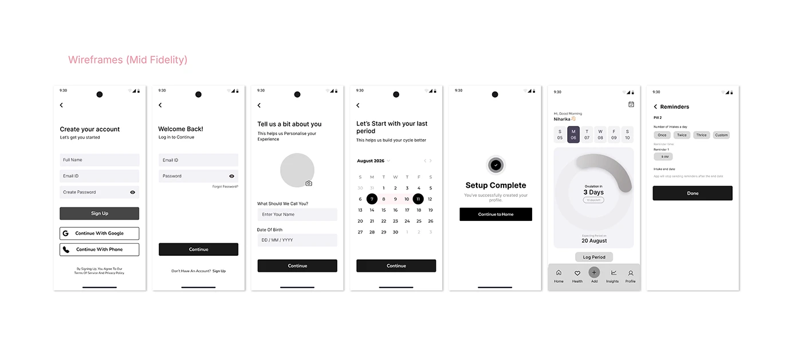

# OVIAH mid-fidelity wireframes: greyscale signup, onboarding and reminders screens in a row

**Discipline:** app · **Design type:** Wireframe showcase · **Design style:** Minimalist
**Tags:** wireframes, mid-fidelity, greyscale, onboarding, ux-process

## What it is
Seven greyscale phone wireframes labelled 'Wireframes (Mid Fidelity)': create account, login, name and photo entry, date of birth, calendar setup, a setup-complete screen with a placeholder ring, and a reminders list with pill frequency options.

## What it means
Structural and honest; showing bare wireframes before the styled screens proves the layout was solved first.

## Techniques
- Strip colour and imagery to test layout alone.
- Sequence wireframes in the exact order a user experiences them.
- Use placeholder circles for imagery not yet designed.

## Best for
- UX process documentation
- Wireframe presentations
- Design critique decks

## Vocabulary
- **Mid-fidelity wireframe** — A layout mockup with structure but no final visual style.
- **Placeholder** — A temporary stand-in for content not yet finalised.
