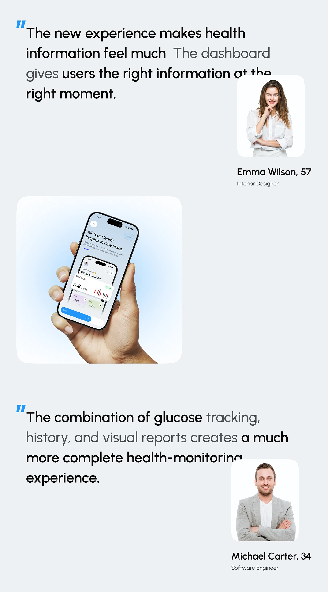

# Pale Blue Testimonial Quotes with Portraits

**Discipline:** app · **Design type:** Research insight slide
**Tags:** testimonials, quotes, pale-blue, portraits, phone, tone-shift

## What it is
A tall pale slide with two large quotes where phrases shift between black and grey, each paired with a rounded portrait tile, name and role, and a hand-held phone in a glowing tile between them.

## What it means
Big quotes with rounded portraits feel personal and trustworthy, and the tone shifts guide reading.

## Techniques
- Oversized quote marks in the accent blue
- Black-to-grey phrase shifts inside a quote
- Portrait tile overlapping the quote text edge
- Name, age and job as a caption under each face
- A product tile breaking up the two quotes

## Best for
- Case-study feedback sections
- Testimonial slides
- Health-tech portfolios

## Vocabulary
- **Quote block** — A large statement from a user with an attributed portrait.
- **Tone shift** — Changing text between dark and light greys to guide reading.
- **Portrait tile** — A rounded square photo used as an avatar.
