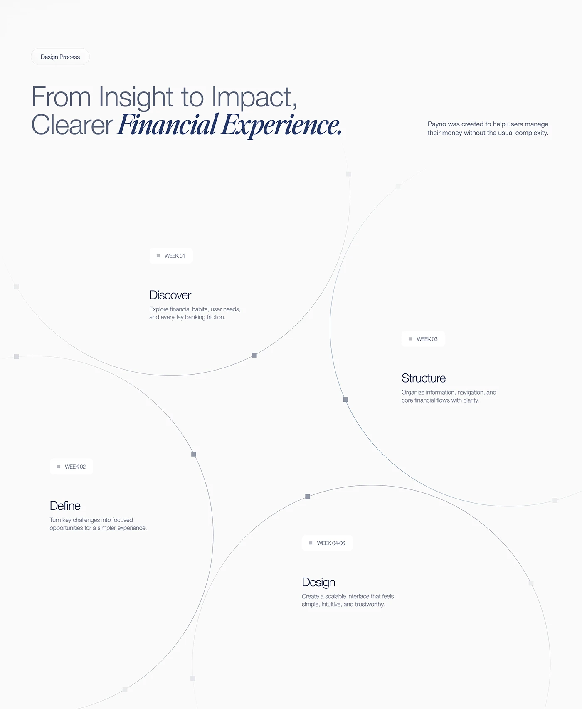

# Four-Week Process in Overlapping Circles

**Discipline:** app · **Design type:** Process slide
**Tags:** process, circles, weeks, minimal, pale, serif-italic, timeline

## What it is
A near-white slide with a two-typeface headline and four huge overlapping thin-line circles, each labelled with a week tag, a stage name (Discover, Define, Structure, Design) and a one-line description.

## What it means
Overlapping circles suggest stages that build on one another. Hairline strokes keep it elegant.

## Techniques
- Giant hairline circles as containers for each stage
- Small square nodes at the circle intersections
- Week chips above each stage title
- Light sans with italic serif emphasis in the headline
- Circles cropped by the canvas edges

## Best for
- Case-study process slides
- Time-boxed project phases
- Minimal editorial layouts

## Vocabulary
- **Overlapping circles** — Circles that intersect to show connected stages.
- **Node marker** — A tiny square or dot on a line marking a point.
- **Week chip** — A small label with a time range.
