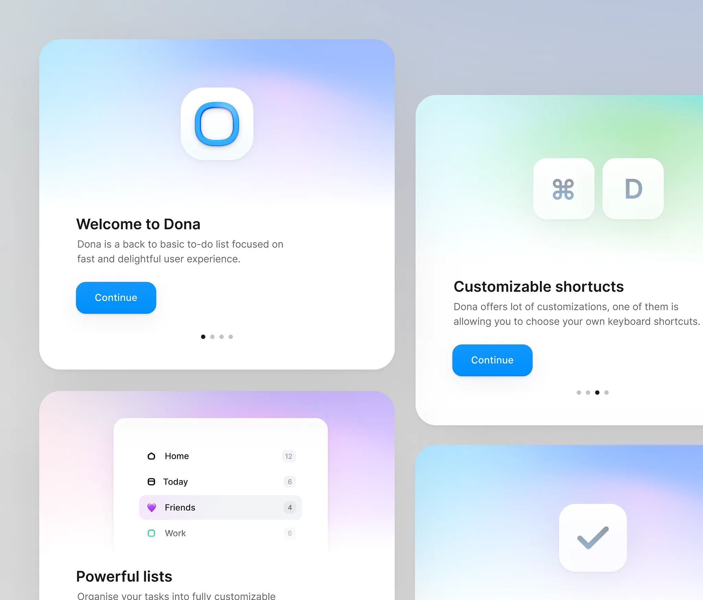

# Gradient onboarding cards for a to-do app: app icon, keyboard shortcut keys, list preview and check tile, with blue Continue pills

**Discipline:** app · **Design type:** Onboarding screens
**Tags:** onboarding, cards, pastel-gradient, blue, icons, keys, page-dots, desktop-app

## What it is
A grey board with rounded white cards each topped by a soft gradient (sky blue to lilac, mint, pink) holding a hero object: a glossy blue-ring app icon on white, two keycaps 'command' and 'D', a sidebar list of Home, Today, Friends and Work with counts, and a check tile; below each a heading, a grey description, a blue Continue pill and page dots.

## What it means
Light and delightful; gradient tops make each feature a small gift.

## Techniques
- Give each card a different soft gradient top.
- Put one hero object per card.
- Use a single blue Continue pill.
- Add four page dots.

## Best for
- Desktop and mobile onboarding
- Productivity app tours
- Pastel gradient cards

## Vocabulary
- **Gradient card top** — A soft gradient area above the text of a card.
- **Keycap illustration** — A keyboard key drawn as an object.
- **Page dots** — Small dots showing carousel position.
- **Hero object** — The main icon on a card.
