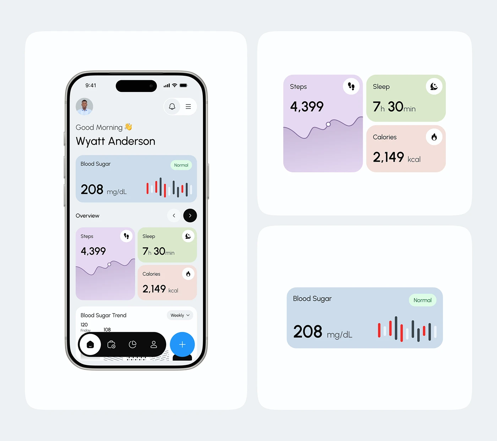

# Pastel Health Dashboard with Metric Cards

**Discipline:** app · **Design type:** Health app screens
**Tags:** health, pastel, cards, steps, sleep, calories, blood-sugar

## What it is
Three white rounded panels on light grey: a phone with a greeting, a blue blood sugar card, and pastel purple, green and peach cards for steps, sleep and calories; and two panels isolating those cards at large scale.

## What it means
Each metric gets its own pastel, so the dashboard reads at a glance, and enlarged cards show the design details.

## Techniques
- One pastel per metric category
- Isolated component crops beside the full screen
- Bold numerals with small units
- Red and dark bars for the blood-sugar spark chart
- Dark pill navigation with a blue plus button

## Best for
- Health-tracking apps
- Component showcases within case studies
- Data cards with soft colours

## Vocabulary
- **Metric card** — A card showing one measure and its trend.
- **Unit suffix** — A small unit label set next to a large number.
- **Component isolation** — Showing one UI piece large on its own.
