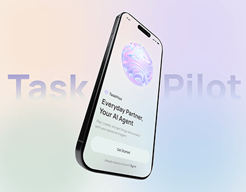

# Pastel Mesh AI Agent Phone with Ghost Name

**Discipline:** app · **Design type:** Device mockup scene
**Tags:** pastel, mesh-gradient, ai-agent, ghost-type, tilted, iridescent, cover

## What it is
A pastel peach, lilac and mint mesh cover with a tilted phone showing a welcome screen with an iridescent 3D orb, headline 'Everyday Partner, Your AI Agent' and a Get Started button, with 'Task Pilot' ghost lettering split around it.

## What it means
Soft mesh colours and a pearly orb feel calm and futuristic, and the split ghost name frames the phone.

## Techniques
- Mesh gradient of soft pastels
- Iridescent orb as the AI symbol
- Ghost name split by the device
- Steeply tilted phone
- Simple white CTA card

## Best for
- AI assistant and agent apps
- Pastel gradient covers
- Onboarding hero images

## Vocabulary
- **Mesh gradient** — A multi-point colour blend with organic transitions.
- **Iridescent** — Shimmering with shifting colours like a soap bubble.
- **Split name** — A brand name divided by an object in front.
