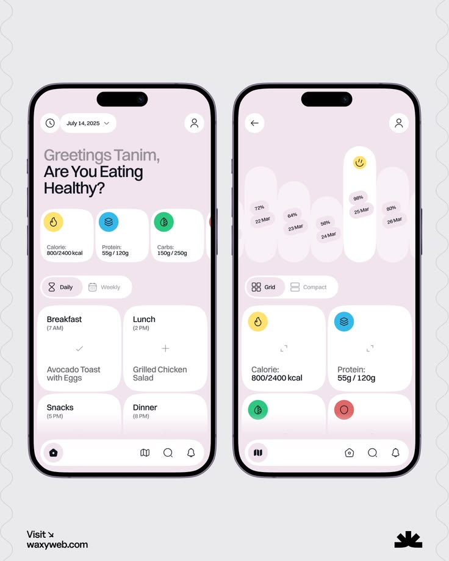

# Pastel Pink Healthy-Eating Tracker

**Discipline:** app ·  · **Design style:** Geometric & Bauhaus
**Tags:** nutrition, pastel, pink, cards, tracker, icons, two-phones

## What it is
Two phones on a grey field: a home screen with a greeting, macro cards with colored icon dots (calories, protein, carbs) and meal tiles, and a second screen with pill-shaped daily bars and a grid of macro cards.

## What it means
Pastel pink with white cards and small saturated icons feels gentle and encouraging rather than clinical.

## Techniques
- Icon dots in yellow, blue, green as category codes
- Tall pill bars as a calendar-style chart with a smiley on the best day
- Two-tone greeting where the question is in black
- Segmented Daily/Weekly control
- Floating pill navigation bar

## Best for
- Nutrition and wellness apps
- Consumer health trackers
- Friendly onboarding-free dashboards

## Vocabulary
- **Macro card** — A small card showing one nutrient's progress.
- **Pill bar chart** — Vertical rounded bars representing days.
- **Two-tone greeting** — A header with muted name line and bold question.
