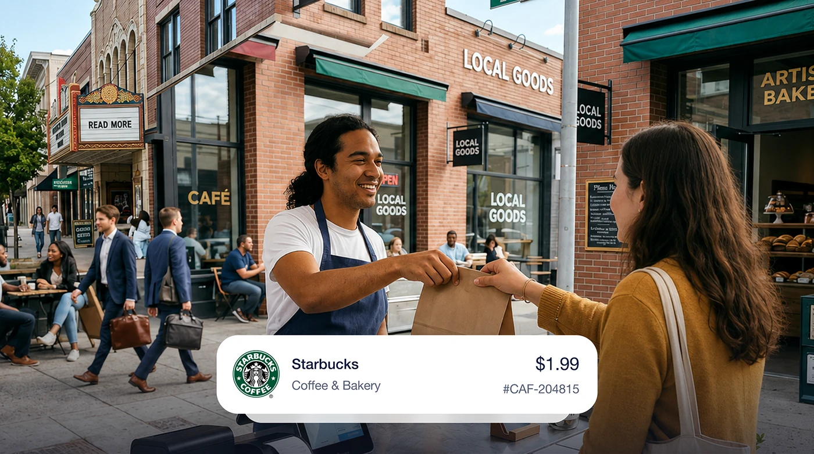

# Frosted transaction card overlaid on a candid street purchase photo

**Discipline:** app ·  · **Design style:** Glassmorphism
**Tags:** payments, transaction-card, photo-overlay, frosted, lifestyle, fintech, receipt

## What it is
A photograph of a barista handing a paper bag to a customer on a bustling street. A large white frosted card at the bottom shows a merchant logo, name, category, price and reference number.

## What it means
Human and contextual; the receipt card links the number to a real moment.

## Techniques
- Overlay a translucent UI card on a lifestyle photo to connect data with life.
- Use a clean row layout: logo, name and category left, amount right.
- Choose a candid, sunlit street photo with depth.
- Let the card partially cover the photo's lower area.

## Best for
- Fintech marketing and case-study visuals
- Explaining transaction features
- Onboarding illustrations

## Vocabulary
- **Overlay card** — A UI card placed over a photograph.
- **Merchant row** — A list item showing logo, name and amount.
- **Lifestyle context** — A photo that shows real use of a product.
- **Frosted glass** — A translucent blurred panel.
