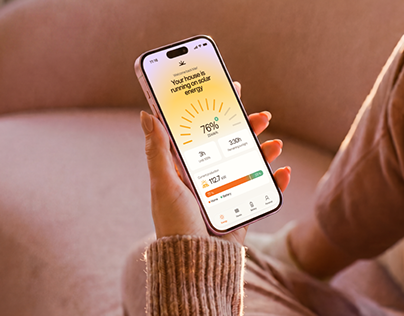

# Solar Energy App on a Pink Sofa

**Discipline:** app · **Design type:** Device mockup scene
**Tags:** pink, peach, sofa, hand, solar, lifestyle, warm

## What it is
A woman's hand holds a phone showing an orange sunburst gauge (76% solar) against a soft pink sofa and knit sleeve.

## What it means
Warm pinks and a sunburst gauge feel cosy and optimistic, linking energy to home comfort.

## Techniques
- Lifestyle setting matched to the UI colours
- Sunburst radial gauge as a signature graphic
- Shallow depth of field on the sofa
- Warm sweater texture in the foreground
- Peach and orange UI accents

## Best for
- Home energy apps
- Lifestyle mockups
- Warm-toned consumer brands

## Vocabulary
- **Sunburst gauge** — A radial gauge with rays around a percentage.
- **Lifestyle mockup** — A device shown in a real domestic setting.
- **Tonal match** — Scene and UI sharing the same colour family.
