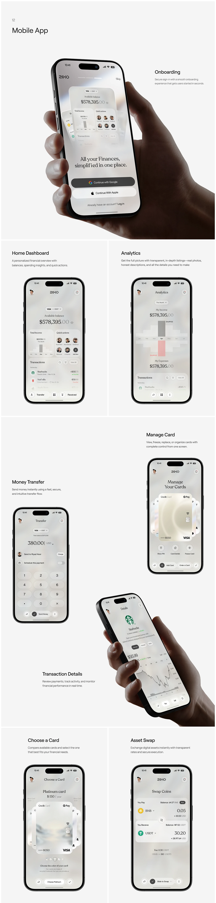

# Pearl Grey Mobile App Long Sheet

**Discipline:** app ·  · **Design style:** Glassmorphism
**Tags:** banking, pearl, long-scroll, hand, screens, serif, captions, grey

## What it is
A tall pale grey sheet titled Mobile App with a large hand-held onboarding screen, then rows of phones with captions for Home Dashboard, Analytics, Money Transfer, Manage Card, a hand-held Transaction Details, Choose a Card and Asset Swap in pearl and grey glass.

## What it means
A uniform pearl palette and short captions make a full banking app read as one calm product.

## Techniques
- Hand-held hero screen opening the sheet
- Alternating caption sides per screen
- Pearl and grey glass UI throughout
- Serif numerals for balances
- Two hand-held shots as rhythm breaks

## Best for
- Banking app case-study pages
- Long screen showcases
- Pearl-toned fintech UI

## Vocabulary
- **Pearl palette** — Soft iridescent whites and greys.
- **Caption pair** — A short heading and description beside a screen.
- **Rhythm break** — A different image type placed among repeated ones.
