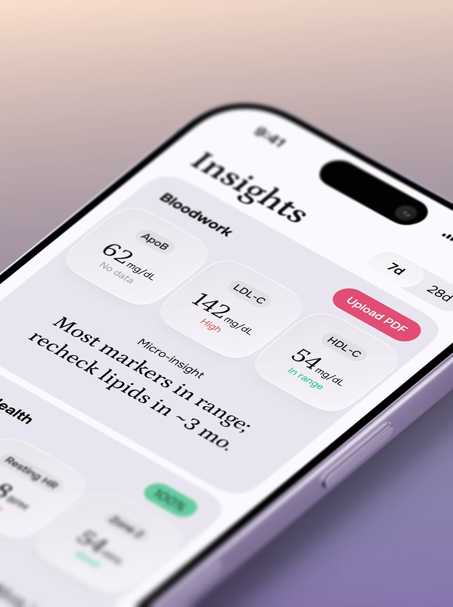

# Extreme close-up of a lilac phone: serif Insights title, blood markers on glass tiles and a pink Upload PDF pill

**Discipline:** app ·  · **Design style:** Glassmorphism
**Tags:** health, close-up, serif, glass, lilac, pink, insights, perspective

## What it is
A steep perspective close-up of a lilac phone on a peach-to-violet gradient showing a serif 'Insights' title, a Bloodwork card with three glass tiles (ApoB, LDL-C, HDL-C), a serif sentence about rechecking lipids, 7d/28d toggles, a pink Upload PDF pill and blurred lower tiles with a green 100% pill.

## What it means
Human and precise; big serif type and glass tiles make lab results feel gentle.

## Techniques
- Shoot the phone in extreme perspective with depth blur.
- Use serif for headings and insights.
- Highlight one action in pink.
- Keep tiles frosted with status colours.

## Best for
- Health-data app covers
- Close-up UI shots
- Serif-led health interfaces

## Vocabulary
- **Perspective close-up** — An angled, magnified view of a device.
- **Depth blur** — Focus fall-off across the image.
- **Micro-insight** — A short plain-language finding.
- **Action pill** — A coloured capsule for the main action.
