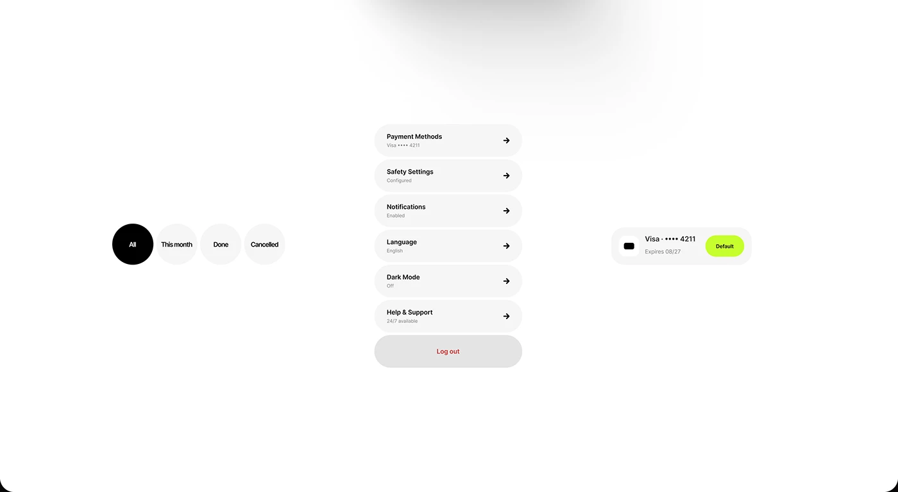

# Circular filter chips, pill-row settings menu and a lime Default card row on white

**Discipline:** app ·  · **Design style:** Dark & Neon
**Tags:** components, ui-kit, white, black, lime, pills, settings, filters

## What it is
A white canvas with three isolated components: four round filter chips (All selected in black), a vertical stack of grey pill rows with arrows for settings and a grey Log out pill in red, and a payment card row with a lime Default pill.

## What it means
Tactile and tidy; extreme rounding and grey tones feel friendly and systematic.

## Techniques
- Make list rows full pills with title and grey subtitle.
- Use black for selected and pale grey for unselected chips.
- Use one lime tag to mark the default option.
- Show components isolated on white.

## Best for
- Component library showcases
- Settings and account screens
- Rounded neutral UI systems

## Vocabulary
- **Pill row** — A list item shaped like a capsule.
- **Filter chip** — A small toggle for filtering a list.
- **Default tag** — A label marking the primary choice.
- **Component isolate** — A UI element shown alone on a blank canvas.
