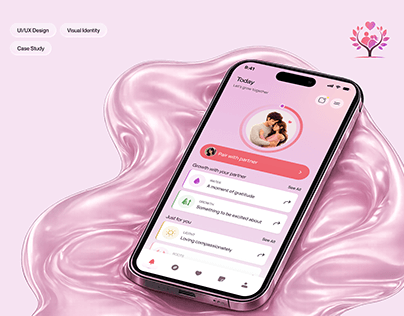

# Couples App on a Glossy Pink Swirl

**Discipline:** app · **Design type:** Device mockup scene
**Tags:** pink, liquid, glossy, couples, phone, tags, cover

## What it is
A pink cover with a phone lying on a glossy liquid pink swirl showing a Today screen with a couple's photo ring and pink cards, discipline pills at top left and a heart-tree logo at top right.

## What it means
The glossy liquid matches the pink UI and gives a sensual, soft mood for a relationship app.

## Techniques
- Liquid glossy 3D swirl as the stage
- Monochrome pink scene and UI
- Pill tags for disciplines
- Circular photo with a progress ring
- Logo in the corner

## Best for
- Relationship and wellness apps
- Monochrome pastel covers
- Liquid 3D scene staging

## Vocabulary
- **Liquid render** — A glossy flowing 3D surface resembling paint or gel.
- **Photo ring** — A circular photo with a progress outline.
- **Monochrome scene** — A scene in one colour family.
