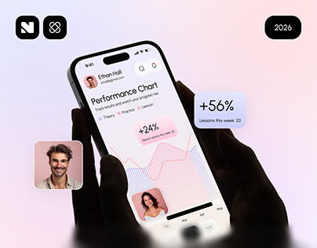

# Pink Performance Chart in Black Hands

**Discipline:** app · **Design type:** Device mockup scene
**Tags:** pink, chart, hands, floating-cards, learning, blur, cover

## What it is
A pastel pink and lilac cover with black hands holding a phone showing a performance chart of pink and blue bars, with floating portrait tiles and a '+56% lessons this week' card, and logo chips.

## What it means
Floating people and stat cards make data feel social and encouraging, and the black hands give strong contrast.

## Techniques
- Floating portrait tiles and stat cards around the phone
- Blurred bottom fade into the background
- Pink line-and-bar chart as the main graphic
- Black hands as the darkest element
- Year pill and logo chips as cover metadata

## Best for
- Learning and progress-tracking apps
- Data storytelling covers
- Soft-tone consumer education

## Vocabulary
- **Stat float** — A statistic card floating outside the device.
- **Portrait tile** — A rounded photo square used as an avatar or testimonial.
- **Bottom blur** — A blur fade at the base of an image.
