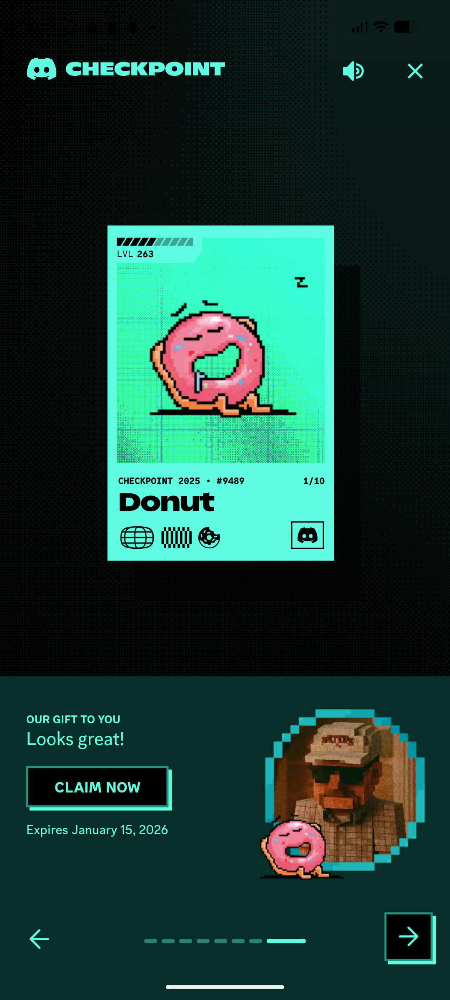

# Pixel Collectible Card Reveal Screen

**Discipline:** app · **Design type:** Gamified app screens
**Tags:** pixel-art, gamification, mint, dark, collectible, card, retro, year-in-review

## What it is
A phone screenshot of a year-in-review feature with a dark halftone-dot background and mint accents: a mint collectible card with a level bar, a pixel-art sleepy donut character, a heavy title and small badges, and a lower panel 'Our gift to you' with a black Claim Now button with an offset outline, a pixel avatar and dotted page progress with a boxed arrow.

## What it means
Pixel art, dotted textures and offset outlines create a playful retro-game mood that makes a summary feel like a reward.

## Techniques
- Collectible trading-card layout
- Pixel-art character on a mint dither gradient
- Halftone dot texture on a dark background
- Offset outline on buttons and arrow tile
- Dashes as page progress

## Best for
- Gamified rewards and year-in-review screens
- Retro pixel-art UI
- Collectible card interfaces

## Vocabulary
- **Halftone dots** — A dot pattern giving a printed or dithered texture.
- **Collectible card** — A card with a level, title, number and badges like a trading card.
- **Offset outline** — An outline shifted behind a shape for a hard shadow effect.
