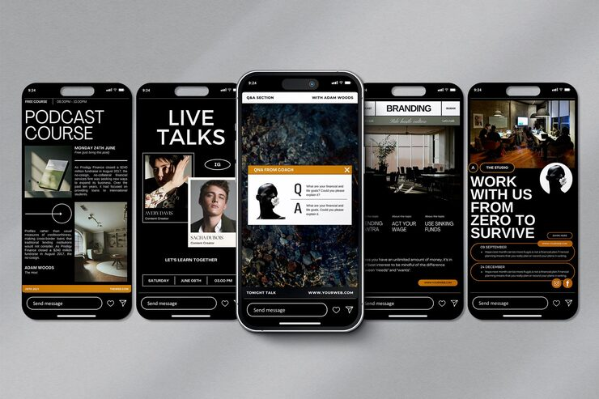

# Fanned phone mockups showing an orange/black portfolio story set

**Discipline:** app · **Design type:** Device mockup scene · **Design style:** Editorial
**Tags:** phone mockup, stories, orange black, portfolio, editorial, fan layout

## What it is
Five phone mockups fanned out on a grey background, each displaying a different story screen (podcast, live talks, Q&A, branding, work-with-us) from one cohesive orange-and-black portfolio brand.

## What it means
A fanned multi-device arrangement lets a designer showcase a full story sequence at once, giving viewers the sense of flipping through a real Instagram highlight reel.

## Techniques
- fan multiple device mockups at slight angles to show a sequence as one composition
- hold a strict two-color (orange/black) system across every screen for instant brand recognition
- mix full-bleed photography screens with pure typographic screens for pacing

## Best for
- personal brand/portfolio story highlights
- case study presentation of a social system
- creative agency self-promotion

## Vocabulary
- **device mockup fan** — a presentation arrangement showing multiple screens on angled, overlapping device frames
