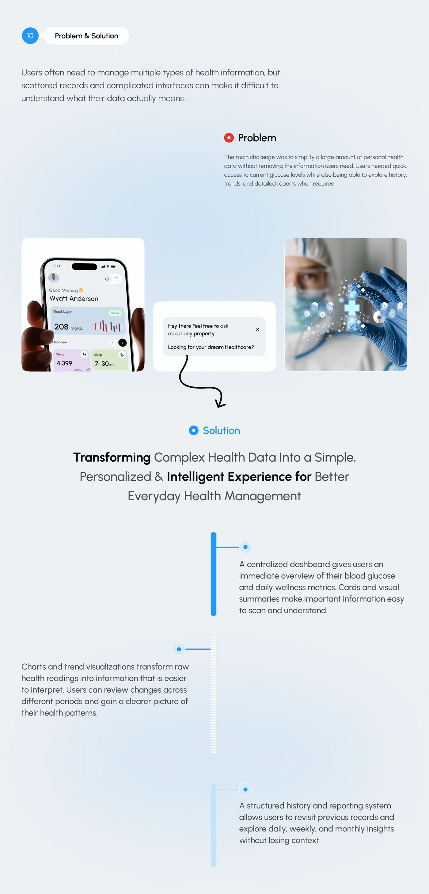

# Problem and Solution Blue Timeline

**Discipline:** app · **Design type:** Process slide
**Tags:** problem, solution, timeline, blue, photos, chat, light

## What it is
A pale slide with a numbered Problem & Solution pill, a red Problem heading, three image tiles (phone, chat prompt with a curly arrow, medical photo), a blue Solution heading and a vertical blue bar timeline with three paragraphs alternating sides.

## What it means
The red-to-blue shift shows the move from problem to solution, and the timeline bars keep the reading order clear.

## Techniques
- Red dot for problem, blue dot for solution
- Hand-drawn curly arrow linking image to statement
- Vertical blue bar with side dots
- Paragraphs alternating left and right
- Bold key words in a light headline

## Best for
- Problem and solution slides
- Case-study narrative sections
- Health product stories

## Vocabulary
- **Colour coding** — Using colour to signal meaning, like red for problem.
- **Vertical timeline** — A line with points and text alternating along it.
- **Hand-drawn arrow** — A sketchy arrow adding informal direction.
