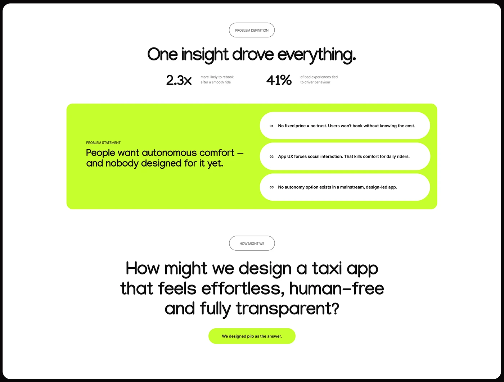

# Problem definition slide with a lime panel holding three white pills

**Discipline:** app ·  · **Design style:** Dark & Neon
**Tags:** case-study, problem-statement, lime, white, pills, stats, how-might-we, rounded-frame

## What it is
A white rounded slide with black border. Outlined pill tags 'Problem definition' and 'How might we' introduce sections; a large headline, two stat callouts (2.3x, 41%), a big lime panel with a problem statement on the left and three white capsule reasons on the right, and a lime pill saying the product is the answer.

## What it means
Clear, punchy and confident; lime panel signals the crux of the case study.

## Techniques
- Use outlined pill tags as section labels.
- Place a bright lime panel to isolate the problem statement.
- List reasons as white capsules with small numbers.
- Show two stats in plain type above the panel.
- End with a lime pill that names the solution.

## Best for
- Case-study problem and insight slides
- UX storytelling
- Neon-accent portfolios

## Vocabulary
- **Problem statement panel** — A highlighted block stating the core problem.
- **Numbered capsule** — A rounded list item with a small number.
- **How-might-we** — A design-thinking question framing a challenge.
- **Outlined pill tag** — A bordered capsule labelling a section.
