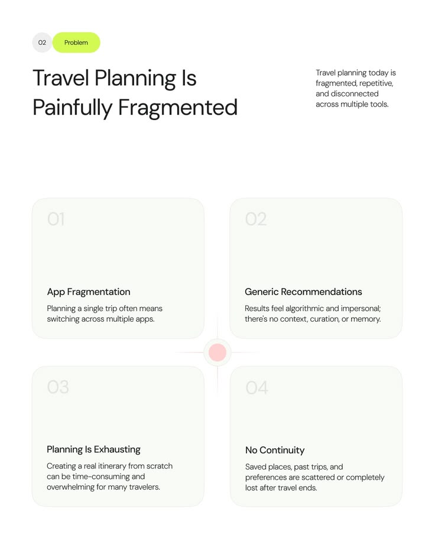

# Four Problem Cards with a Central Pink Node

**Discipline:** app ·  · **Design style:** Minimalist
**Tags:** problem, cards, white, lime, pink-node, numbered, minimal

## What it is
A white slide with a lime Problem pill, a large headline 'Travel Planning Is Painfully Fragmented', a side paragraph and a 2-by-2 grid of soft cards with faint numerals 01 to 04 and problem titles and descriptions, joined by a glowing pink node with cross rays at the centre.

## What it means
Very faint cards and one pink node make four problems feel like parts of one issue, and the lime pill is the only bright colour.

## Techniques
- 2-by-2 grid of faint cards
- Ghost numerals at the top of each card
- Pink glowing node with rays at the grid centre
- Lime pill for the section label
- Text anchored to the card base

## Best for
- Problem statement slides
- Four-part comparisons
- Travel and AI case studies

## Vocabulary
- **Ghost numeral** — A very faint number marking an item.
- **Centre node** — A glowing dot linking a grid of items.
- **Problem slide** — A slide listing the issues a project addresses.
