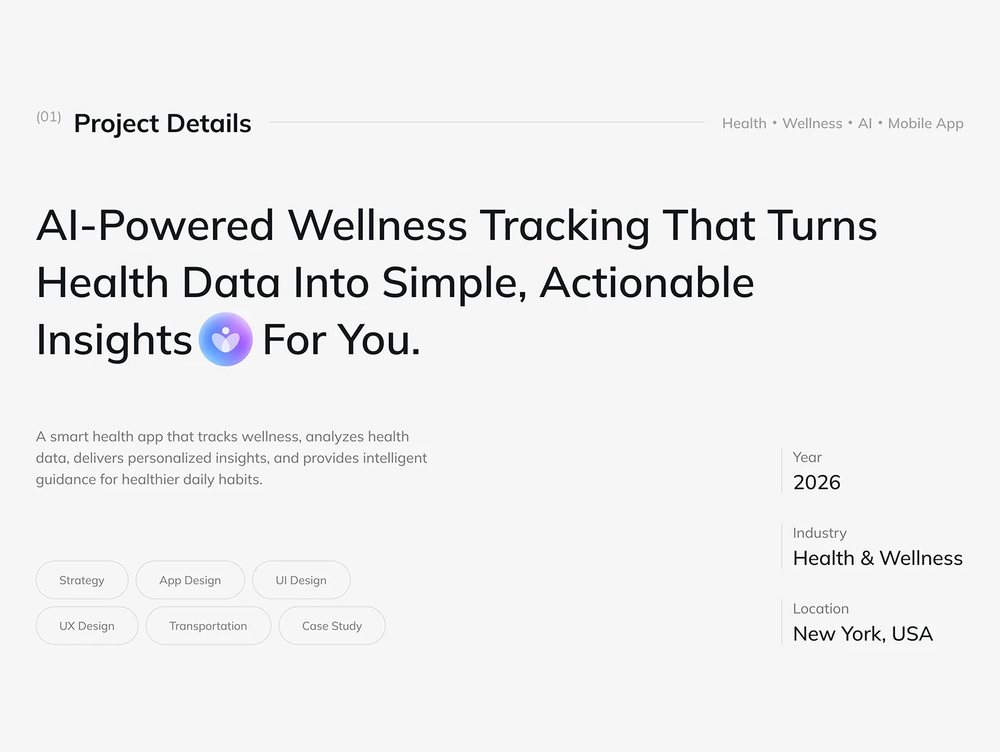

# Project Details with Inline Logo Headline

**Discipline:** app ·  · **Design style:** Corporate & Clean-Tech
**Tags:** project-details, grey, inline-logo, pills, metadata, light, health

## What it is
A light grey slide titled Project Details with a tag list, a large headline with a gradient app logo set inline between words, a short description, discipline pills and a right column of year, industry and location.

## What it means
The logo inside the headline is a small brand moment, and pills and metadata organise the facts.

## Techniques
- Logo dropped inline within a headline
- Outlined pills for disciplines
- Right column of labelled facts with a vertical rule
- Header tag list of themes
- Generous white space

## Best for
- Project details slides
- Health and wellness case studies
- Intro slides with metadata

## Vocabulary
- **Inline logo** — A logo placed within a line of text.
- **Discipline pills** — Rounded outlines listing services provided.
- **Fact column** — A column of small labels and values.
