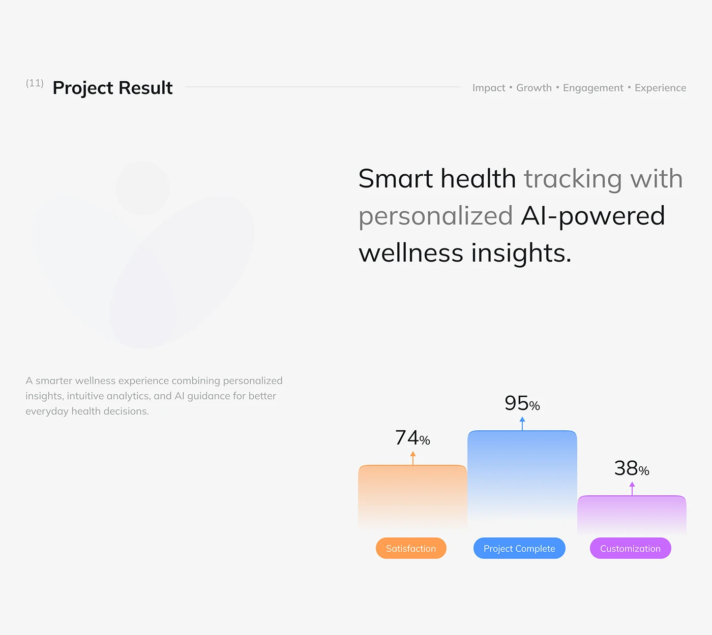

# Project Result with Gradient Percent Bars

**Discipline:** app ·  · **Design style:** Gradient & Aurora
**Tags:** results, bars, orange, blue, purple, grey, logo-watermark

## What it is
A light grey slide titled Project Result with a two-tone headline about smart health tracking, a faint brand mark watermark, and three rounded gradient bars in orange, blue and purple with percentages and pill labels.

## What it means
Soft fading gradient bars and pill labels make results friendly, and each colour is tied to its metric.

## Techniques
- Bars that fade from colour to transparent at the base
- Pill labels in matching colour under each bar
- Arrow above each value with the percentage
- Faint brand shape as watermark
- Tag list across the header

## Best for
- Project result slides
- Health-tech case studies
- Three-metric summaries

## Vocabulary
- **Fade bar** — A bar whose colour fades toward its base.
- **Metric pill** — A coloured label naming a metric.
- **Header tag list** — Words separated by dots beside a slide title.
