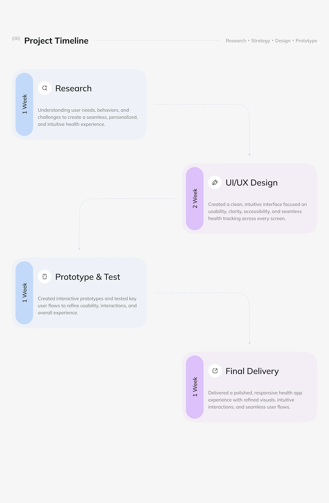

# Staggered Project Timeline Cards

**Discipline:** app ·  · **Design style:** Minimalist
**Tags:** timeline, cards, blue, lilac, week-pills, dotted-arrows, grey

## What it is
A grey slide titled Project Timeline with four alternating cards (Research, UI/UX Design, Prototype & Test, Final Delivery), each with a vertical rounded duration pill, an icon, a description and dotted elbow arrows leading to the next.

## What it means
Alternating blue and lilac cards with arrows make sequence and duration clear at a glance.

## Techniques
- Cards stepping left and right down the page
- Vertical duration pills in blue and lilac
- Dotted elbow arrows between cards
- Small icon in a white circle per card
- Header with numbered title and tag list

## Best for
- Project timelines
- Process summaries
- Duration-based workflow slides

## Vocabulary
- **Duration pill** — A vertical rounded label showing how long a phase takes.
- **Elbow arrow** — A right-angled dotted arrow linking cards.
- **Alternating layout** — Items placed left then right to create a zigzag.
