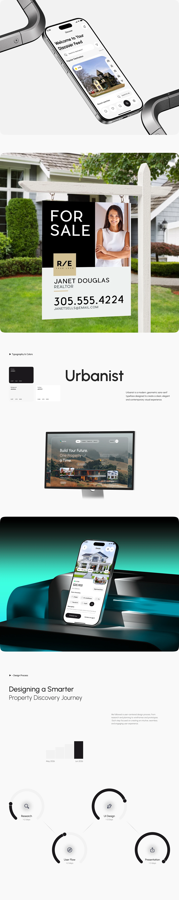

# Property App Long Case Study with For-Sale Sign

**Discipline:** app ·  · **Design style:** 3D & Surreal
**Tags:** real-estate, long-scroll, white, sign, monitor, teal, process

## What it is
A very tall white case-study page: a phone between chrome pipes, a For Sale yard sign mockup with agent photo, a type specimen 'Urbanist', a website on a monitor, a phone on teal glass forms and a design process of four ring nodes.

## What it means
Real-world signage next to app screens shows a brand across print, web and app, and a calm white page keeps focus.

## Techniques
- Yard sign mockup as a print touchpoint
- Type specimen with small palette tiles
- Teal glowing 3D scene for the app hero
- Ring nodes for process steps
- Alternating text bands and image bands

## Best for
- Real estate brand and app case studies
- Long-form portfolio pages
- Cross-medium identity showcases

## Vocabulary
- **Touchpoint mockup** — A realistic mockup of the brand on a physical item.
- **Ring node** — A circular progress-style marker for a process step.
- **Long case study** — A tall page telling a project story in sections.
