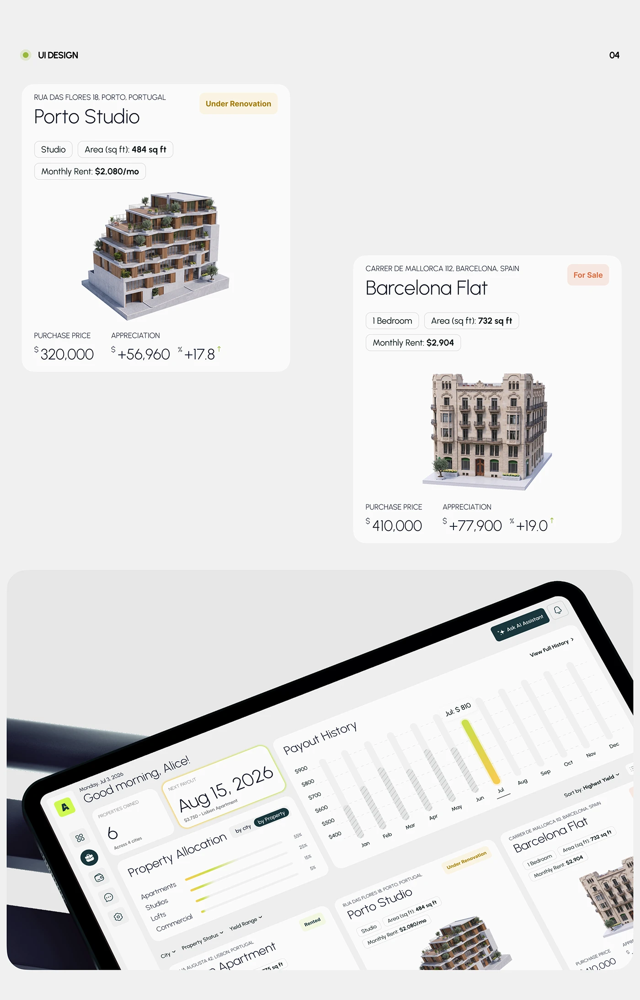

# Two light property cards with 3D building models, and a tilted tablet dashboard with a gradient bar chart

**Discipline:** app ·  · **Design style:** 3D & Surreal
**Tags:** real-estate, 3d-buildings, cards, light-grey, lime, tablet, bar-chart, status-tags

## What it is
A board 'UI Design 04' with two white property cards for a studio and a flat, each with address, status tag, spec pills, a 3D isometric building and purchase and appreciation figures in light numerals; and a tilted tablet dashboard with greeting, next payout card, allocation bars, payout history with hatched and lime bars, and property cards.

## What it means
Tangible and calm; 3D buildings connect numbers to real assets.

## Techniques
- Show each asset as a 3D building.
- List specs in outlined pills.
- Use hatched bars with one lime bar.
- Present components flat and in a tilted dashboard.

## Best for
- Property investment apps
- Card-level UI documentation
- Light lime dashboards

## Vocabulary
- **Isometric model** — A 3D building rendered from an angle.
- **Status tag** — A small label like Under Renovation.
- **Spec pill** — A capsule listing a property attribute.
- **Hatched bar** — A bar filled with diagonal lines.
