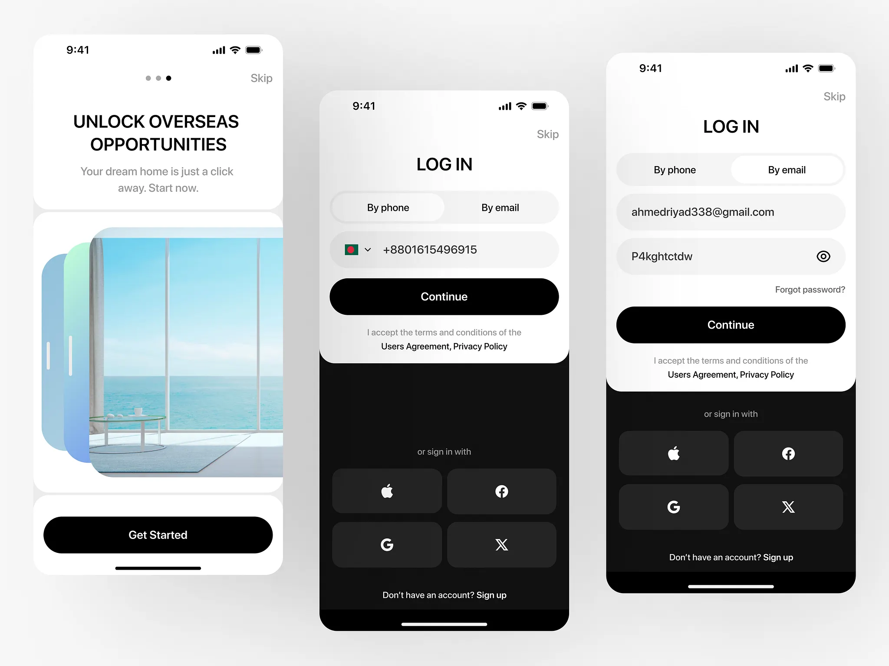

# Three white screens: onboarding with a layered sea-view photo, log in by phone and log in by email with dark social block

**Discipline:** app · **Design type:** Onboarding screens
**Tags:** onboarding, login, black, white, layered-photo, segmented-tabs, social-sign-in, real-estate

## What it is
A pale grey background with three staggered phones: onboarding with 'UNLOCK OVERSEAS OPPORTUNITIES', a stack of gradient panels and a sea-view window photo and a black Get Started pill; log in by phone with a segmented control, flag field and black Continue plus a dark block of Apple, Facebook, Google and X buttons; and log in by email with email and password fields.

## What it means
Clean and modern; black pill buttons and a dark social block create a clear hierarchy.

## Techniques
- Layer gradient panels behind a photo.
- Use a segmented control for phone or email.
- Contrast a white form with a dark social block.
- Keep black primary pills.

## Best for
- Login and onboarding design
- Property and travel apps
- Monochrome mobile flows

## Vocabulary
- **Layered photo** — A photo with gradient panels stacked behind.
- **Segmented tabs** — A toggle between two input modes.
- **Dark social block** — A black area with sign-in provider buttons.
- **Flag field** — A phone input with a country flag.
