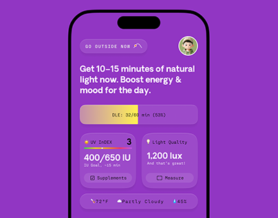

# Violet daylight app with a yellow progress bar, UV gradient and translucent tiles

**Discipline:** app · **Design type:** Health app screens
**Tags:** health, violet, yellow, glass-tiles, uv-index, progress-bar, monospace, project-thumbnail

## What it is
A saturated violet phone screen with a translucent 'Go outside now' pill and avatar, a two-line bold prompt, a yellow-filled bar showing 53%, and two frosted tiles with a UV index rainbow bar and a lux reading, above a weather row.

## What it means
Bright and encouraging; violet with yellow bar suggests sunlight indoors.

## Techniques
- Use translucent tiles on a saturated field.
- Fill a bar with yellow to signal sunlight.
- Set headlines bold and readings in monospace.
- Show a rainbow scale for UV.

## Best for
- Daylight, wellness and habit apps
- Single-colour app screens
- Small thumbnails

## Vocabulary
- **Frosted tile** — A translucent tile over a colour field.
- **UV scale** — A colour gradient bar for UV levels.
- **Monospace reading** — A number set in monospace type.
- **Prompt headline** — A bold instruction at the top.
