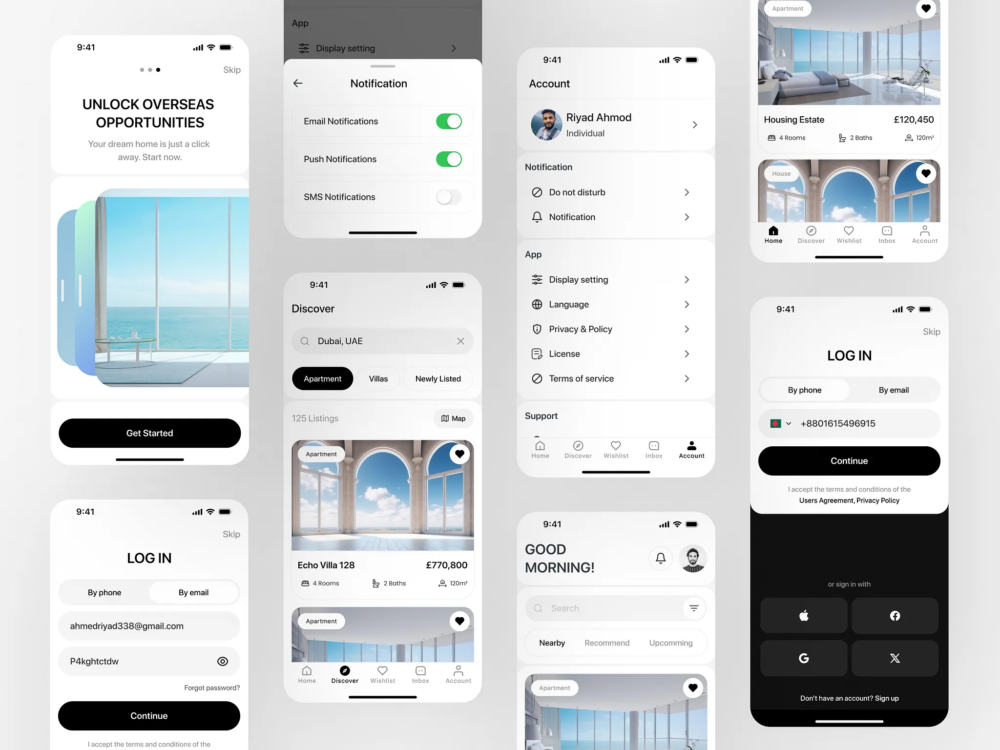

# Monochrome property app flow: onboarding, log in, discover listings, account, notifications and social sign-in on a dark base

**Discipline:** app · **Design type:** Fintech app screens
**Tags:** real-estate, monochrome, black, white, onboarding, login, listings, toggles

## What it is
A pale grey board with rows of white and black phones: an onboarding 'UNLOCK OVERSEAS OPPORTUNITIES' with a layered sea photo and a black Get Started, log in with phone or email tabs and a black Continue, a dark social sign-in block, a Discover screen with search, filter pills and photo listing cards with heart buttons and a price, an Account list with sections, a Notification sheet with green toggles and a Good Morning home.

## What it means
Clean and premium; black buttons and airy photos suit international property.

## Techniques
- Use black pills for primary actions.
- Split login into white form and dark social block.
- Show listings with round heart buttons.
- Use green only for toggles.

## Best for
- Property and travel app UI kits
- Monochrome mobile systems
- Login and account screens

## Vocabulary
- **Segmented login** — A toggle switching between phone and email.
- **Listing card** — A photo card with price and specs.
- **Social sign-in block** — A dark area of provider buttons.
- **Settings toggle** — A green switch for a notification type.
