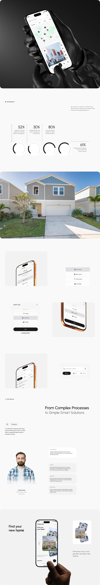

# Real Estate App Long Case Study

**Discipline:** app · **Design type:** Case study slide
**Tags:** real-estate, long-scroll, research, persona, white, gloved-hand, orange-bezel

## What it is
An extremely tall white case study: a black gloved hand holding a map-based property app, research stats with ring gauges, a full-width house photo, orange-bezel phones showing filters, a persona block and a closing hero with 'Find your new home'.

## What it means
A restrained white page with photos and orange-edged devices keeps a long story clean and readable.

## Techniques
- Dark hero image opening a very white page
- Ring gauges for research percentages
- Full-bleed real photo as a break
- Copper phone frames repeated as a motif
- Persona portrait beside short need statements

## Best for
- Real estate and property tech
- Long case-study pages
- Research-to-solution storytelling

## Vocabulary
- **Ring gauge** — A circular progress ring showing a percentage.
- **Full-bleed photo** — An image extending to the edges of the canvas.
- **Motif frame** — A repeated device bezel colour used across images.
