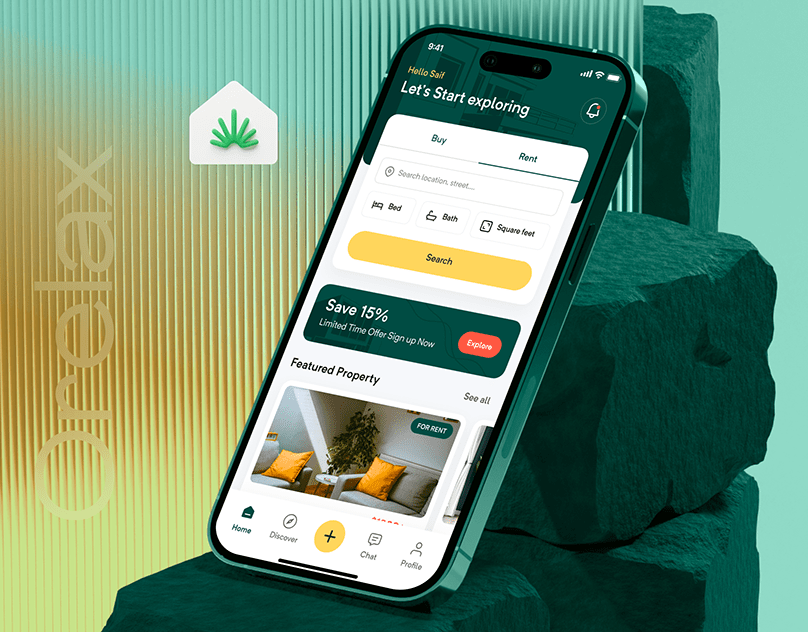

# Real-estate app on an emerald 3D rock and ribbed glass stage

**Discipline:** app ·  · **Design style:** 3D & Surreal
**Tags:** real-estate, mockup, emerald, yellow-accent, 3d-rocks, ribbed-glass, phone-tilted

## What it is
A tilted phone leans on green rocks in front of a ribbed glass panel with a vertical 'Orelax' wordmark and a leaf-house icon. The app screen has a dark green header, a buy/rent search card with a yellow button, a promo banner and a property card.

## What it means
Fresh, natural and trustworthy; yellow gives a friendly hit of energy against forest green.

## Techniques
- Build the presentation set from the brand colours (green, yellow) in 3D.
- Use ribbed glass as a soft translucent backdrop with vertical gradient stripes.
- Set a giant faint wordmark vertically to add brand presence without clutter.
- Tilt the phone against a rock to add dynamism and shadow.

## Best for
- Property, travel and lifestyle app launches
- Case-study covers
- Nature-tied brands

## Vocabulary
- **Ribbed glass** — A fluted translucent texture with vertical ridges.
- **Tilted mockup** — A device angled to feel dynamic.
- **Search card** — A raised panel holding search fields and one primary button.
- **Vertical wordmark** — Brand name rotated 90 degrees.
