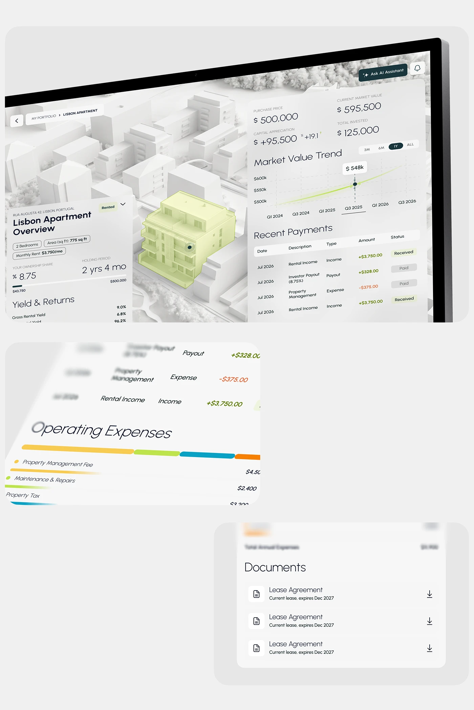

# Investment property dashboard on a white 3D city model with lime-highlighted building

**Discipline:** app ·  · **Design style:** Glassmorphism
**Tags:** dashboard, real-estate, 3d-map, lime, white, perspective, charts, glass

## What it is
A pale tilted monitor showing a white 3D model of a neighbourhood with one building highlighted in translucent lime. Frosted panels carry property overview, holding stats, yield, a market value line chart and a payments table. Blurred detail crops of expenses bars and a documents list are shown below.

## What it means
Refined and tangible; the highlighted building ties abstract numbers to a physical asset.

## Techniques
- Use a monochrome white 3D map with one lime-tinted focus object.
- Place frosted panels over the map.
- Show a thin line chart with a lime glow.
- Add blurred zoomed crops to show detail.

## Best for
- Real-estate and asset dashboards
- Spatial data products
- Light premium interfaces

## Vocabulary
- **Spatial highlight** — Colouring one object on a map.
- **Frosted panel** — A blurred translucent data panel.
- **Zoom crop** — An enlarged detail shown beside the full screen.
- **Monochrome map** — A map rendered in one neutral colour.
