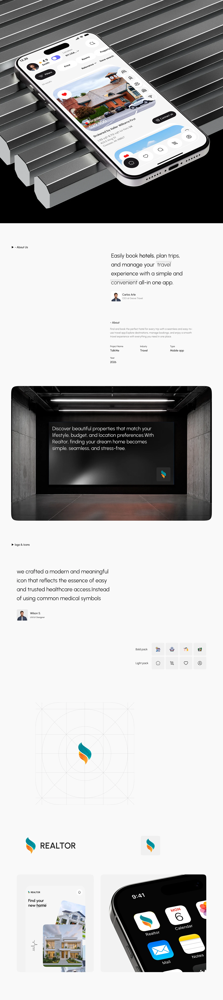

# Realtor App Long Case Study with Logo Grid

**Discipline:** app · **Design type:** Case study slide
**Tags:** real-estate, long-scroll, logo, grid, icon-packs, chrome, white

## What it is
A very tall white case study with a phone on chrome steps, an About section, a dark concrete room with an overlay message, a logo and icons section with a construction grid for a teal and orange flame mark, bold and light icon packs and app icon mockups.

## What it means
Showing the mark on its construction grid and as an icon makes the identity feel rigorous, and dark chrome scenes add drama to a light page.

## Techniques
- Logo shown on a construction grid
- Bold and light icon packs side by side
- Dark concrete room image as a full-width break
- Chrome step props for the hero phone
- App icon shown beside system icons

## Best for
- App case studies including identity
- Real estate branding
- Long-scroll portfolio pages

## Vocabulary
- **Icon pack** — A set of icons in one style, such as bold or light.
- **Construction grid** — Guides showing the geometry of a logo.
- **Full-width break** — A wide image separating text sections.
