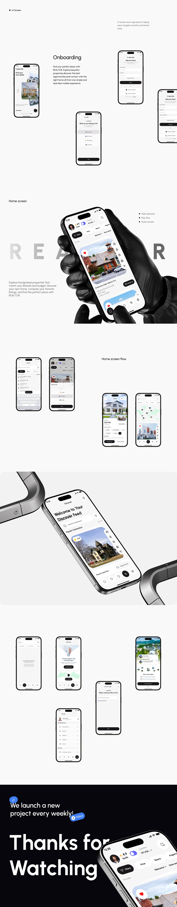

# Realtor App Screens Long Sheet with Thanks

**Discipline:** app · **Design type:** Case study slide
**Tags:** real-estate, long-scroll, screens, gloved-hand, ghost-type, chrome, closing

## What it is
A very tall white page with scattered phones for onboarding and login, a home screen in a black gloved hand over faint 'REALTOR' letters, screen flow rows, a large tilted phone between chrome brackets and a dark closing section with 'We launch a new project every weekly!' and a Thanks for Watching heading with a phone.

## What it means
A sparse white layout with occasional dramatic images keeps a long screen list interesting.

## Techniques
- Small phones scattered with generous space
- Dramatic gloved-hand hero mid-page
- Chrome bracket props for a large tilted phone
- Dark closing section after white content
- Section labels in tiny type

## Best for
- Long screen documentation
- Real estate app portfolios
- Case studies with a dark ending

## Vocabulary
- **Scattered layout** — Elements spaced irregularly on a page.
- **Gloved hand** — A dark glove used to hold a device in a stylised render.
- **Dark ending** — A closing section in black after light sections.
