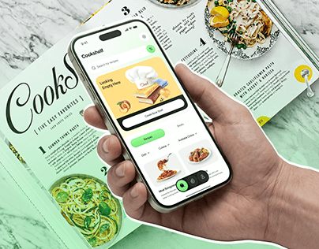

# Recipe App over Cookbook Cutout

**Discipline:** app ·  · **Design style:** Photographic & Cinematic
**Tags:** recipe, cookbook, hand, mint, cutout, food, thumbnail

## What it is
A cover with a hand holding a phone running a green recipe app, cut out with a white outline over a mint-toned open cookbook with oversized lettering.

## What it means
The printed cookbook backdrop connects the digital app to its analog roots. The white cutout outline gives a sticker-like pop.

## Techniques
- Sticker-style white outline around the hand and phone
- Color-tinted photo background matching the UI green
- Big editorial title text partially hidden behind the device
- Food photography inside the app screen
- Playful yellow accent card in the UI

## Best for
- Food and recipe apps
- Cover thumbnails
- Concepts bridging print and digital

## Vocabulary
- **Cutout outline** — A white border around a masked subject.
- **Tinted backdrop** — A photo colour-graded toward the brand hue.
- **Analog metaphor** — Using a physical object to explain a digital product.
